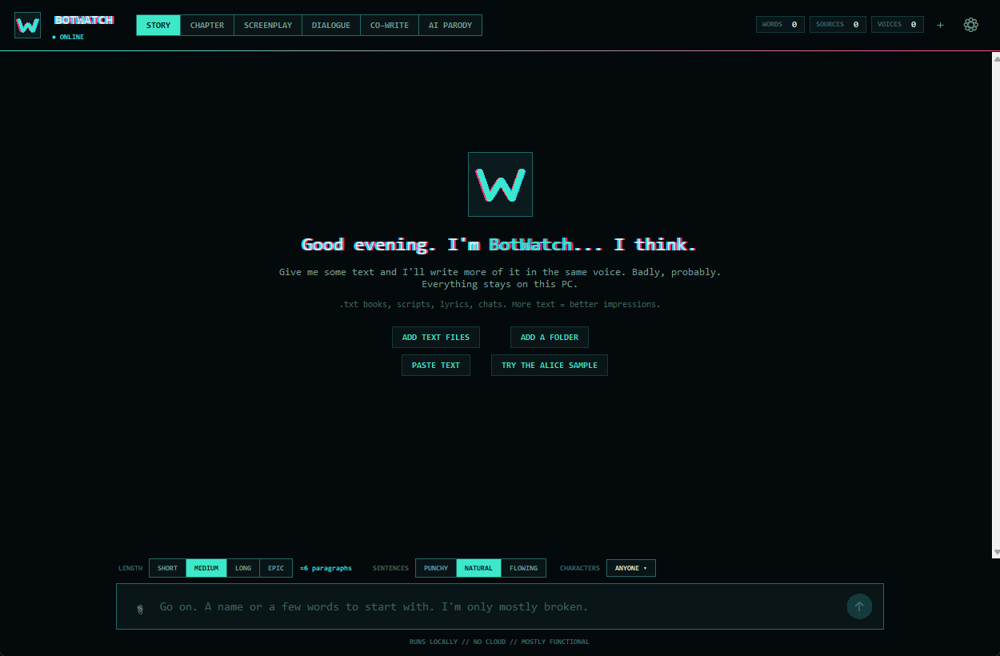
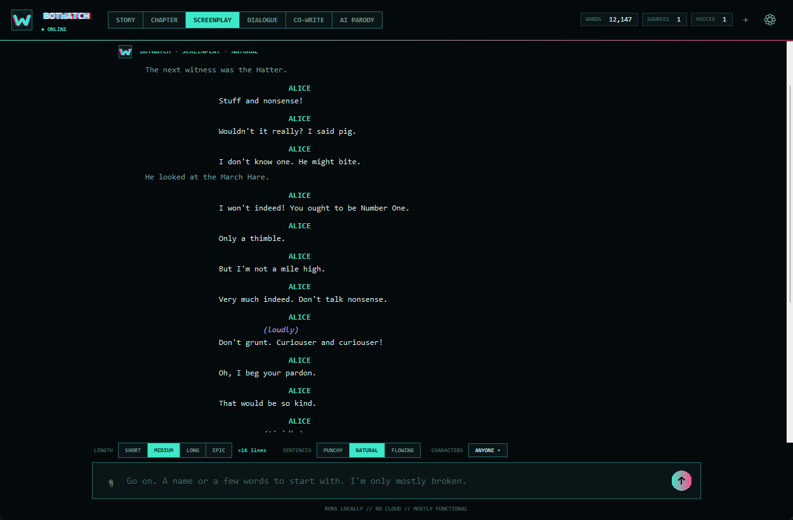
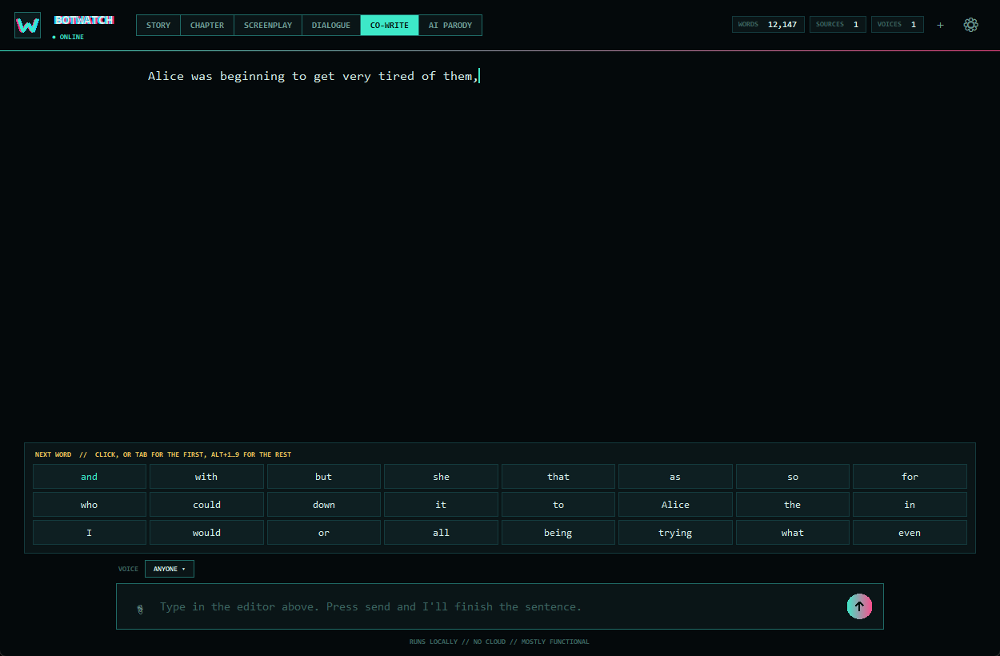
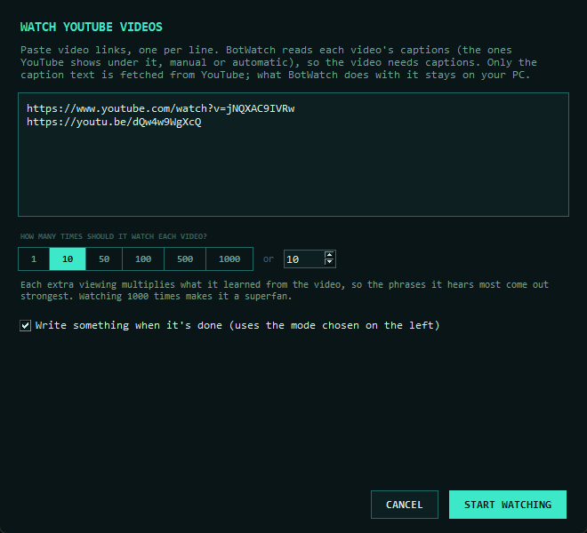
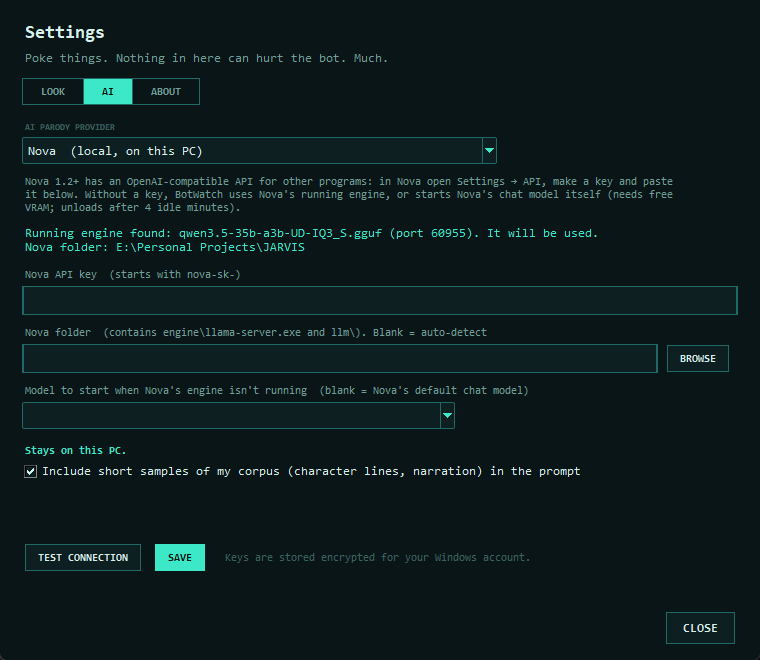

# BotWatch

**Feed a bot some text. It learns how it sounds, then writes something new in the same voice.**
Stories, chapters, screenplays and dialogue, with each character keeping their own voice. Runs on your Windows PC: no account, no telemetry, and nothing leaves your PC unless you choose a cloud AI provider for the optional AI Parody mode.

### [⬇ Download BotWatch.exe (latest release)](https://github.com/Wolklaw/botwatch-releases/releases/latest)

No installer: download the `.exe` and double-click it. A first-launch Windows SmartScreen warning ("unknown publisher") is expected for small unsigned apps; choose *More info → Run anyway*. The release includes a SHA-256 checksum. The app has the public-domain sample book (*Alice's Adventures in Wonderland*) built in: click **Try the Alice sample** on the start screen.

Part of [wolklaw.dev](https://wolklaw.dev), styled like [Nova](https://wolklaw.dev/projects/nova/).

## How to use it

Controls are on the left, the output is on the right.

1. **01 // Sources**: **＋ Files**, **＋ Folder**, **Paste**, **▶ Watch YouTube videos**, or **Alice sample**. More text means better writing. Your sources are remembered next launch.
2. **02 // Mode**: **Story**, **Chapter**, **Screenplay**, **Dialogue**, **Co-write** or **AI Parody**.
3. **03 // Options**: length (Short to Epic), sentence style (Punchy / Natural / Flowing), which characters speak, and optional words to start with (`Alice`, `The door opened`).
4. **04 // Tune**: Personality (Stable / Mild / Very broken), Creativity and Faithfulness (loose remix to close to the source).
5. Press **GENERATE** (or Ctrl+Enter). Text decodes onto the screen in matrix green; click it or press Esc to skip the animation.

| Screenplay | Co-write |
|---|---|
|  |  |

## Let it watch YouTube

Click **▶ Watch YouTube videos**, paste some links, and choose how many times it should watch each one, from 1 to 1000. BotWatch reads each video's captions (manual or automatic, so the video needs captions), learns from them, and can write something straight away in the mode you picked. Every extra viewing makes the phrases it hears most come out stronger, so a bot that has watched a video 1000 times is a bit of a superfan.

Only the caption text is fetched from YouTube (it needs the internet for that moment); what BotWatch does with it stays on your PC. Videos you've watched are remembered at launch without asking YouTube again.

## The modes

- **Story / Chapter / Screenplay / Dialogue**: Markov-chain writing, fully offline. It cleans the text, learns who says each line, and filters out repeats, fragments, run-ons and long copies of the source.
- **⌨ Co-write**: *you* write; the bot suggests the 24 most likely next words (click, or Tab / Alt+1…9). Pick a Voice to write like one character, or press Auto-write to let it finish your sentence.
- **🤖 AI Parody** *(optional)*: a language model writes a deadpan, absurd chapter using your text's cast and voice. Choose your provider in **⚙ Settings → AI**:
  - **Local (stays on your PC):** **[Nova](https://wolklaw.dev/projects/nova/)** (use Nova 1.2's built-in API with a key from Nova's Settings → API; without a key it falls back to Nova's running engine, or starts Nova's chat model), **Ollama**, or any OpenAI-compatible local server such as LM Studio or llama.cpp.
  - **Cloud (needs your own API key):** **Anthropic (Claude)**, **OpenAI**, **Google Gemini**, **OpenRouter**, **Groq**, **Mistral**, **xAI (Grok)**, **DeepSeek**, **Together AI**, or any custom OpenAI-compatible endpoint. With a cloud provider, your premise and (if you leave it ticked) short samples of your text are sent to that provider. Keys are stored encrypted for your Windows account.

## Settings

⚙ in the top-right: **Glitch level** (Off / Low / Full), the decode animation, the matrix rain, and the AI provider. **Save brain / Load / Reset** are at the bottom of the left panel.

## Good to know

- Windows 10/11, 64-bit. Plain UTF-8 `.txt` files work best.
- Settings are saved to `.botwatch_settings.json` in your user folder.
- Books whose text lost its quote marks (bad OCR) are used for narration only.
- YouTube videos need captions. Some videos have none, or have captions turned off, and YouTube sometimes blocks caption requests from a connection: try again later or from another network.
- Provider model names change over time; use **Fetch models** in the AI settings to see what your key can use.

## Feedback

Found a bug or have an idea? [Open an issue](https://github.com/Wolklaw/botwatch-releases/issues) or email hello@wolklaw.dev.
