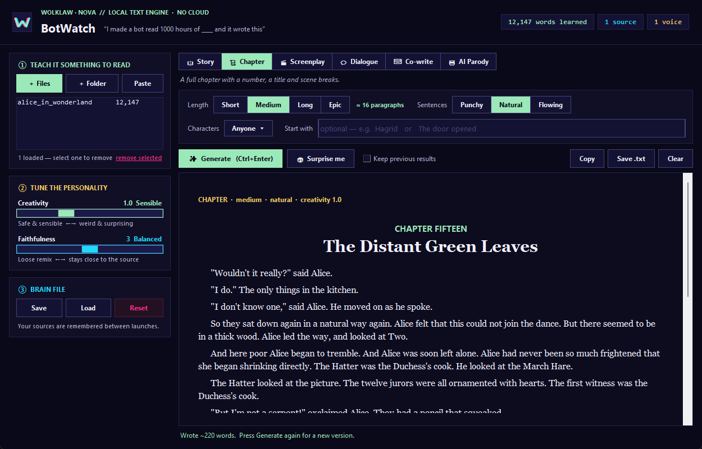

# BotWatch

**Feed a bot some text. It learns how it sounds, then writes something new in the same voice.**
Stories, chapters, screenplays and dialogue, with each character keeping their own voice. Runs entirely on your Windows PC: no cloud, no account, no telemetry.

### [⬇ Download BotWatch.exe (latest release)](https://github.com/Wolklaw/botwatch-releases/releases/latest)

No installer: download the `.exe` and double-click it. A first-launch Windows SmartScreen warning ("unknown publisher") is expected for small unsigned apps; choose *More info → Run anyway*. The release includes a SHA-256 checksum, and a public-domain sample book (*Alice's Adventures in Wonderland*) to try it with.

Part of [wolklaw.dev](https://wolklaw.dev).

## How to use it

1. **Teach it**: click **＋ Files** or **＋ Folder** and pick some `.txt` books, scripts or lyrics (try the included Alice sample). More text means better writing. Your sources are remembered next launch.
2. **Pick what to write**: **Story**, **Chapter**, **Screenplay**, **Dialogue**, **Co-write** or **AI Parody**.
3. **Shape it**: choose a length (Short to Epic), sentence style (Punchy / Natural / Flowing), which characters speak, and optionally some words to start with (`Alice`, `The door opened`).
4. **Press Generate** (Ctrl+Enter). Press it again for a new version. 🎲 **Surprise me** picks random settings.

| Screenplay | Co-write |
|---|---|
|  |  |

## The modes

- **Story / Chapter / Screenplay / Dialogue**: pure Markov-chain writing, fully offline. It cleans the text, learns who says each line, and filters out repeats, unfinished sentences and long copies of the source.
- **⌨ Co-write**: *you* write; the bot suggests the 24 most likely next words (click, or Tab / Alt+1…9). Pick a Voice to write like one character, or let it **Auto-write a sentence**. This is how the famous "predictive text wrote a chapter" memes are made.
- **🤖 AI Parody** *(optional)*: asks a language model to write a deadpan, absurd chapter using your text's cast and voice. Use **Ollama** (local and free) or your own **Anthropic API key**. Only this mode can send anything off your PC, and only if you choose Anthropic (your premise and short samples of your text are sent; you can turn samples off in ⚙ AI settings).

## Good to know

- Windows 10/11, 64-bit. Plain UTF-8 `.txt` files work best.
- Settings are saved to `.botwatch_settings.json` in your user folder. If you use the Anthropic provider, the key is stored there too.
- Books whose text lost its quote marks (bad OCR) are used for narration only.

## Feedback

Found a bug or have an idea? [Open an issue](https://github.com/Wolklaw/botwatch-releases/issues) or email hello@wolklaw.dev.
